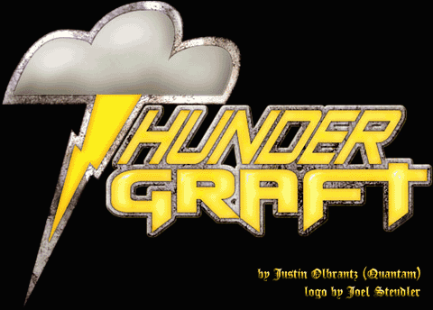

# ThunderGraft

## What It Is

ThunderGraft is an MPQDraft plugin that adds additional music-playing capabilities to Diablo, Diablo II, StarCraft, and Warcraft II: Battle.net Edition. In addition to PCM WAV audio files, which are supported natively by these games (either used uncompressed or compressed via MPQ WAV compression, which is based on lossy ADPCM compression), ThunderGraft adds the ability to play newer, superior audio compression formats: MPEG Layer-3 Audio (MP3), Ogg Vorbis (Ogg), and Free Lossless Audio Codec (FLAC). All of these give noticeably higher audio quality and (with the exception of FLAC) significantly smaller file sizes than MPQ WAV compression. ThunderGraft uses miniaudio for decoding and playing audio.

The supported games set the sound card to output 22 khz audio, as that is what their sound effects and music use. ThunderGraft plays music on an output device of its own, at the music's own sampling rate, so higher quality music is not held back by the games' settings.

ThunderGraft can also replace the games' music with playlists: shuffled or in order, with crossfades, and with music that changes when something happens in the game. See [Playlists](playlists.md).

ThunderGraft is game- and version-independent. ThunderGraft is limited, however, to music and other streamed sounds, including StarCraft map trigger sounds; it does not work with sound effects that are not streamed.

## How to Use It

ThunderGraft is easy to use. Simply put the music files in an MPQ with WinMPQ or some other MPQ file editor (as with WAV files prior to ThunderGraft), then load the MPQ with MPQDraft and the ThunderGraft plugin; do **not** use WAV compression when importing non-PCM WAV files into an MPQ. Note that global music files, such as the opening themes of the various games, have hard-coded paths that require the audio files have a WAV extension; ThunderGraft does not rely on extension, and will play them correctly even if they are not actually WAV files.

ThunderGraft is a single file, `ThunderGraft.qdp`, with no other files it depends on.

### Playlists

To play your own music in place of the game's, with more control than replacing files one by one, put a playlist file, `music\playlist.toml`, in your mod's MPQ. [Playlists](playlists.md) explains how to write one, and how StarCraft maps can bring playlists of their own. The `tgplaylist` tool, released alongside ThunderGraft, checks playlist files and shows what they would play without starting the game.

If a playlist file has a mistake, ThunderGraft doesn't use it, and writes what's wrong to `ThunderGraft.log` next to the game.

ThunderGraft also reads the `playlist.txt` files of ShadowFlare's Playlist Plugin. Using that plugin is discouraged, and running it together with ThunderGraft is not supported.

### Settings

Select ThunderGraft in MPQDraft's list of plugins and click **Configure** for its settings:

- **Debug logs**: writes what ThunderGraft does as the game runs (the functions it hooks, the sounds the game starts and stops, the playlist files it reads, and every change of music) to a file, for tracking down problems. It is off by default. Give the log a full path, or just a file name to put it in the game's folder (or, if that can't be written to, in the Windows temporary folder). The file is started afresh each time the game starts.

The settings are part of the patch: they also go into an SEMPQ made with them, so turn debug logs off again before making an SEMPQ for others, or every player's game will write a debug log. MPQDraft remembers them for the next time.

With debug logs on, problems with playlist files are written to the debug log instead of `ThunderGraft.log`, along with every change of music. You don't need debug logs for those, though: without them, problems go to `ThunderGraft.log`.

## Known Bugs/Side Effects

None known.

## How It Works (Technical)

ThunderGraft targets the Storm DDA system (`SFileDda`). This system handles streaming sounds from archives and disc files. This system supports only PCM WAV audio files; StarCraft added support for lossy ADPCM compression by adding ADPCM compression as a fundamental MPQ compression type; despite being stored as ADPCM, readers see only the uncompressed PCM audio, which the streaming system plays.

ThunderGraft works by simply replacing this system with its own, built on miniaudio. This involves hooking all calls to DDA functions in the game's import table, as well as `GetProcAddress` for games that look them up at runtime. The sounds are read through Storm, so they can come from MPQs or disc files as before, and are decoded and played on ThunderGraft's own output device. ThunderGraft's audio engine starts when the game initializes the DDA system; if it can't start, ThunderGraft passes everything on to Storm, and the game plays its music as it would without ThunderGraft.

For playlists, ThunderGraft also hooks the functions the game opens files with (`SFileOpenFile` and `SFileOpenFileEx`), to know which file each sound is, as the DDA functions only get a file handle; and the functions that open and close archives (`SFileOpenArchive` and `SFileCloseArchive`), to use a StarCraft map's playlist file while the map is loaded. These hooks only watch: they pass every call on unchanged, so other plugins that hook the same functions keep working.

One optional feature of the DDA system is the ability for the caller (the game) to supply its own DirectSound buffer for use in streaming. This not only makes the DDA system use the settings on the buffer, but it also allows the game to modify things such as volume or to get the play state without calling the corresponding DDA function (e.g. `IDirectSoundBuffer::SetVolume` rather than `SFileDdaSetVolume`). This is emulated by watching for changes between the `IDirectSoundBuffer` and playing sound, and updating both as necessary.

For further information, see the source code.

## Update History

See [`CHANGELOG.md`](../CHANGELOG.md).

## Credits

- Research, design, and coding: Justin Olbrantz (Quantam)
- Modernizing and coding: Johan Sjöblom (Ojan)
- Sound engine: miniaudio, by David Reid
- Ogg Vorbis decoding: stb_vorbis, by Sean Barrett
- Playlist files: toml++, by Mark Gillard
- Logo: Joel Steudler

## License

ThunderGraft is available under the Common Development and Distribution License (CDDL) 1.0. miniaudio is available as public domain or under the MIT No Attribution license, stb_vorbis as public domain or under the MIT license, and toml++ under the MIT license; see `third_party` in the source code.
